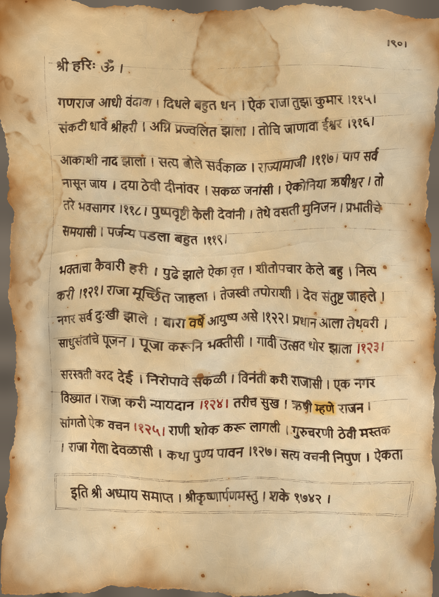
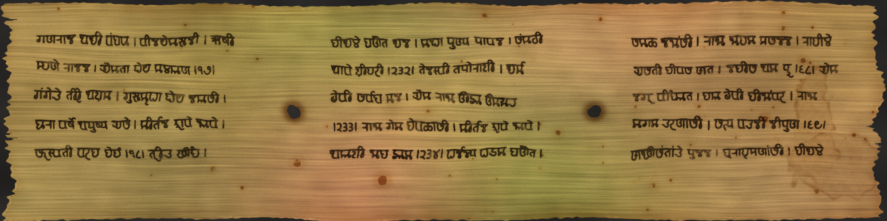
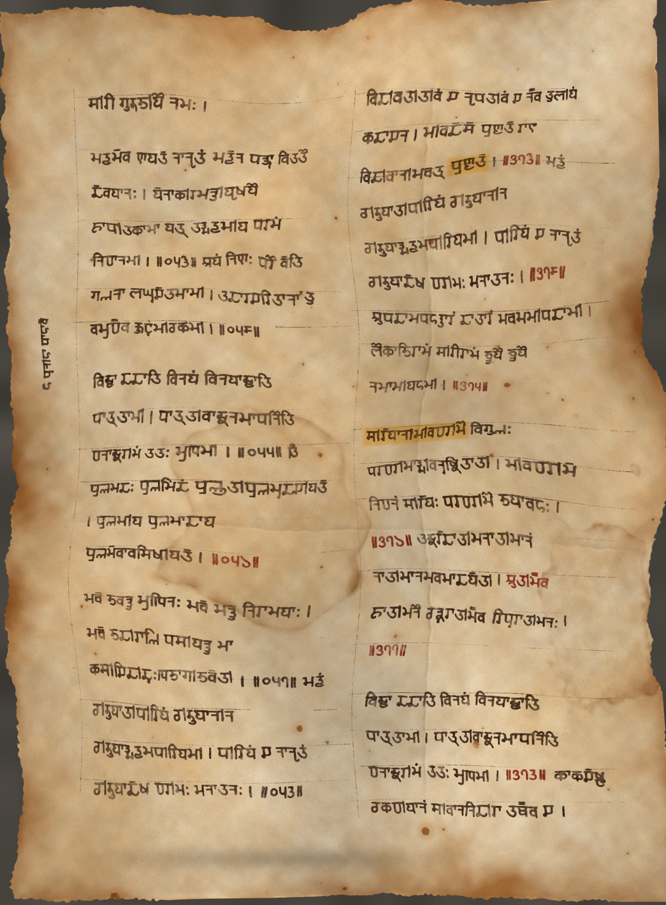

# Synthetic Manuscript Generator

[](https://www.python.org/)
[](https://huggingface.co/datasets/SarthDhakade963/indic-manuscript-dataset)

An end-to-end Python pipeline that synthesizes **historical Indic manuscript folios** in three scripts (**Devanagari, Modi, Sharada**) together with **synchronized ground-truth text**. Every page is saved as a pair, `Image_N.png` and `Image_N.md`, with a `metadata.jsonl` per split. The goal is OCR training data that looks like manuscripts, not like typeset text on a white page.

**Hugging Face dataset:** [`SarthDhakade963/indic-manuscript-dataset`](https://huggingface.co/datasets/SarthDhakade963/indic-manuscript-dataset)

## Samples
| Devanagari (paper) | Modi (palm leaf) | Sharada (parchment) |
|---|---|---|
|  |  |  |

---

## Features

**Materials**
- **Paper:** warm handmade-paper base, multi-scale tonal variation, fine grain, thousands of faint curved fibre strands. The fibre map also drives ink behaviour.
- **Parchment:** golden base, mottled translucency, faint veins, follicle specks. Ink bleeds less than on paper.
- **Palm leaf:** 2000x500 strip with olive-tan colour, longitudinal striations and hairline cracks, straight-cut long edges, ragged split ends and two irregular string holes (transparent in the page mask).

**Aging and damage**
- Patchy yellowing, tide-mark water stains, foxing spots with halos, edge darkening (light / moderate / heavy).
- Crease shadows, torn paper edges with a pale fibrous rim.

**Deformation** (`src/deform.py`)
- Smooth surface warp, edge curl and folds on paper and parchment, and a gentle bow plus uneven lighting on palm leaf.
- The same displacement is applied to the image, the page mask and the text masks, so validation runs on the deformed result.

**Text, layout and ink**
- Five layouts: single block, two columns, main block plus colophon box, short page plus closing formula, three-block palm-leaf strip.
- Hand-ruled lines (slope, waviness and gaps per line), margin notes, folio numbers, running verse numbers in the script's own numerals, danda and double-danda markers.
- Rubricated (vermilion) verse markers and words, and yellow highlighted words.
- Handwriting-style variation: per-line slope, per-word baseline wobble, rotation and gap jitter, a smooth stroke-warp field and pressure drift.
- Inks: iron gall, lampblack (palm leaf, with an incised look) and vermilion. Absorbency-driven bleed, dry patches, granulation, fading over stains, aging toward brown.

**Scripts:** Devanagari, Modi, Sharada, as Unicode text shaped with RAQM.

## Brief vs. implementation
| Requirement | How it is met |
|---|---|
| Palm-leaf and aged paper backgrounds | Palm leaf, paper and parchment, generated procedurally |
| Natural aging, creases, torn edges | Aging engine plus damage engine; palm leaf has its own edge and holes |
| Curling, folds, surface warping | Non-planar surface warping via smooth cubic displacement fields, smoothstep edge curling, fold line deflections, and palm-leaf longitudinal bowing; applied synchronously to RGB image, page mask, and text labels |
| Multiple text blocks, marginal and side text | Five layouts; margin note on about 80% of paper/parchment pages |
| Section / punctuation markers, highlighted text | Dandas with verse numbers, rubrication, yellow wash |
| Natural handwriting | Wobble, slope, warp, pressure variation (see limitations) |
| Ink variation, bleeding, fading | Three inks plus a bleed/fade model |
| Text inside the manuscript | Margins from the torn-edge geometry, plus per-page checks |
| 100 images per script, 85 / 10 / 5 | Generated and verified |
| `python generate.py` | Yes, with `config.json` and CLI flags |
| Hugging Face dataset with three subsets | `devanagari`, `modi`, `sharada` configs, each with train / validation / test |

---

## How it works
```
config.json / CLI
      |
      v
generate.py -> per page: material, aging, ink level, layout from a seeded RNG
      |
      +-> background_generator   material surface -> aging -> damage / edge
      |      (RGB page, alpha page mask, absorbency / fibre / roughness maps)
      +-> corpus + translit      Marathi / Sanskrit source text -> target-script Unicode
      +-> layout.compose         text masks (black, red, yellow wash), ruling, note, folio, label text
      +-> layout.ink_page        ink compositing using the material maps
      +-> deform                 warp / curl / fold on RGB + alpha + text masks together
      +-> checks                 overflow == False and outside_fraction == 0.0, else new seed
      +-> composite on a dark backdrop, save Image_N.png + Image_N.md, write metadata.jsonl
```

**Corpus:** about 80 Marathi pothi-style fragments (for Devanagari and Modi) and 28 Sanskrit verses (for Sharada), drawn without replacement and joined into verses with running verse numbers. About 85% of pages start with an invocation header.

**Layout modes** (paper and parchment; palm-leaf pages always use `palm`):

| Mode | Description | Probability |
|---|---|---|
| `single` | One ruled text block | 35% |
| `two_col` | Two ruled columns with a gutter | 25% |
| `colophon` | Main block plus a double-ruled box with a closing formula | 25% |
| `short` | Text stops partway down, then a centred closer | 15% |
| `palm` | Three blocks around the string holes, no ruling, black ink only | palm leaf |

Devanagari lines are ruled at the headline, Modi lines under the baseline (Modi has no headline).

---

## Installation
Python 3.10+ (developed on 3.12).
```bash
git clone https://github.com/SarthDhakade963/indic-manuscript-generator.git
cd indic-manuscript-generator
conda create -n manuscript python=3.12
conda activate manuscript
pip install -r requirements.txt
```
Pillow needs **RAQM and FriBiDi** for correct Devanagari shaping. Check:
```bash
python -c "from PIL import features; print(features.check('raqm'))"
```
It must print `True`. Without it, the renderer falls back to basic layout and conjuncts break.

### Fonts
Fonts live in `assets/fonts/` (the folder is spelled `devanagiri`); paths are configurable in `config.json`:
```
assets/fonts/devanagiri/NIRMALA.TTC
assets/fonts/modi/NotoSansModi-Regular.ttf
assets/fonts/sharada/NotoSansSharada-Regular.ttf
```
The Noto fonts are SIL OFL. Nirmala UI is a Microsoft font, included only so the private repository runs out of the box. Swap in Noto Sans Devanagari via the `fonts` key if you redistribute.

---

## Usage
```bash
python generate.py                                  # 100 pages per script, 85/10/5 split
python generate.py --workers 4                      # parallel
python generate.py --scripts sharada --count 5 --out output/quick_test
python generate.py --seed 7 --config my_config.json
```
| Flag | Default | Description |
|---|---|---|
| `--config` | `config.json` | JSON file overriding any default |
| `--count` | `100` | Pages per script |
| `--workers` | `1` | Parallel processes |
| `--scripts` | all three | Subset of `devanagari`, `modi`, `sharada` |
| `--seed` | `1234` | Master seed |
| `--out` | `output/dataset` | Output directory |

> `generate.py` **deletes and recreates** the output directory on every run. Use a different `--out` to keep earlier runs.

The full 300-page run took about 20 minutes on the development machine (palm-leaf pages about 2 s, paper and parchment about 7-8 s). Each run also writes a contact sheet per script next to the output folder (`<out>_contact_<script>.png`) and a dataset card inside it.

### Uploading to Hugging Face
```bash
pip install huggingface_hub datasets
huggingface-cli login
python -c "from huggingface_hub import HfApi; a=HfApi(); a.create_repo('SarthDhakade963/indic-manuscript-dataset', repo_type='dataset', private=False, exist_ok=True); a.upload_folder(folder_path='output/dataset', repo_id='SarthDhakade963/indic-manuscript-dataset', repo_type='dataset')"
```

---

## Configuration
Any key left out of `config.json` falls back to its default in `generate.py`.

| Key | Default | Meaning |
|---|---|---|
| `scripts` | all three | Scripts to generate |
| `count_per_script` | 100 | Pages per script |
| `split` | 0.85 / 0.10 / 0.05 | Train / validation / test fractions |
| `seed` | 1234 | Master seed |
| `output_dir` | `output/dataset` | Output folder |
| `workers` | 1 | Parallel processes |
| `font_size` | 38 | Base font size (two-column 0.94x, palm leaf 0.8x) |
| `deform_strength` | 0.75 | Warp, curl and fold strength (0 disables) |
| `max_attempts` | 12 | Retries per page if a check fails |
| `materials` | paper 0.45, parchment 0.15, palmleaf 0.40 | Material mix (weights) |
| `aging` | light 0.3, moderate 0.4, heavy 0.3 | Aging mix (weights) |
| `ink_level` | light 0.1-0.3, moderate 0.4-0.6, heavy 0.7-0.9 | Ink aging range per aging level |
| `sizes` | page 1400x1900, palm leaf 2000x500 | Image sizes |
| `fonts` | see Fonts | Font path and index per script |
| `backdrops` | four dark RGB colours | Colours shown outside the torn edge |

```json
{
  "count_per_script": 100,
  "seed": 1234,
  "workers": 4,
  "deform_strength": 0.75,
  "materials": {"paper": 0.45, "parchment": 0.15, "palmleaf": 0.40}
}
```

---

## Repository structure
```text
generate.py                entry point: generation, validation, split, dataset card, contact sheets
config.json                user-editable parameters
requirements.txt
src/
  material_texture.py      base surfaces: paper, parchment, palm leaf
  aging_engine.py          yellowing, water stains, foxing, edge aging
  damage_engine.py         creases, torn edges, palm-leaf edge and string holes
  background_generator.py  combines the three above; returns image, alpha mask, material maps
  corpus.py                Marathi and Sanskrit source text, verse numbers, headers
  translit.py              Devanagari -> Modi / Sharada Unicode mapping
  text_renderer.py         text to stroke mask; handwriting warp
  layout.py                layouts, ruling, rubrication, highlights, notes, ink pass
  ink_engine.py            ink compositing (bleed, fade, density variation)
  deform.py                warp, curl and fold on image, alpha and masks together
assets/fonts/              fonts
samples/                   example pages
```

---

## Dataset organization
```text
<dataset>/
  README.md                dataset card with the three configs
  devanagari/
    train/        Image_N.png, Image_N.md, metadata.jsonl   (85)
    validation/   ...                                       (10)
    test/         ...                                       (5)
  modi/      train / validation / test
  sharada/   train / validation / test
```
| Split | Ratio | Folios per script |
|---|:---:|:---:|
| Train | 85% | 85 |
| Validation | 10% | 10 |
| Test | 5% | 5 |

`Image_N` is the generation index; the split assignment is a seeded shuffle, so a split's numbers are not contiguous.

`metadata.jsonl` has one row per image. Example (text shortened):
```json
{"file_name": "Image_6.png", "text": "श्री हरिः ॐ ।\n...", "script": "devanagari", "material": "paper", "aging": "moderate", "ink_level": 0.504, "mode": "colophon", "font": "NIRMALA.TTC", "seed": 1587455218, "attempts": 1, "rubricated_words": ["।१२३।", "।१२४।", "।१२५।"], "side_note": "", "folio": "।९०।", "curl": "left", "fold": "", "width": 1400, "height": 1900}
```
| Field | Meaning |
|---|---|
| `text` | same text as the `.md` label |
| `material`, `aging`, `ink_level` | background and ink settings |
| `mode` | layout mode |
| `rubricated_words` | words drawn in red |
| `side_note`, `folio` | margin note and folio text, or empty string |
| `curl` | `left`, `right`, `top`, `bottom` or empty strings |
| `fold` | `vertical`, `horizontal` or empty strings |
| `seed`, `attempts` | page seed and tries needed to pass the checks |

```python
from datasets import load_dataset
ds = load_dataset("SarthDhakade963/indic-manuscript-dataset", "devanagari")
print(ds)                     # train / validation / test
sample = ds["train"][0]
sample["image"].show()
print(sample["text"])
```

---

## Annotation format
`Image_N.md` is plain text, one visual line per line, with no blank lines. The margin note and folio, when present, come last:
```text
श्री हरिः ॐ ।
गणराज आधी वंदावा । दिधले बहुत धन । ऐक राजा तुझा कुमार ।११५।
संकटी धावे श्रीहरी । अग्नि प्रज्वलित झाला । तोचि जाणावा ईश्वर ।११६।
...
।९०।
```
- Lines are in reading order: column 1, then column 2, then colophon or closer.
- On palm leaf, each row has three segments (split around the string holes); a row is written as one line with the segments joined by a space.
- Ruling lines and the colophon box are not part of the text. Rubricated and highlighted words appear as normal text; the red words are listed in `metadata.jsonl`.

---

## Validation and reproducibility
- Every page is checked **after deformation**: `outside_fraction == 0.0` (no ink outside the page or inside a string hole) and `overflow == False` (no line past its margin). A failing page is regenerated with a new seed, up to `max_attempts`; generation stops with an error if it never passes.
- The `.md` text is built from the same layout lines that are rendered, so image and label cannot drift apart.
- All randomness comes from `seed`. Each page derives its own RNG from (`seed`, script index, page index), so the same configuration produces the same dataset, with or without `--workers`.

---

## Possible extensions
- More paper tints and real scanned reference textures (`reference_path` is already supported by the material generator).
- A larger corpus, and verification of the Modi and Sharada mappings by native readers.
- Handwriting-style fonts per script, or per-glyph variants.
- Line-level bounding boxes in `metadata.jsonl` (the layout already knows word and line positions).
- More scripts (the pipeline needs only a font and a Unicode mapping).

## Troubleshooting
| Problem | Fix |
|---|---|
| Devanagari conjuncts look broken | RAQM is missing. Use a Pillow build with RAQM and FriBiDi (conda-forge works). |
| `OSError: cannot open resource` | Font path is wrong. Check `assets/fonts/...` or set `fonts` in `config.json`. |
| `RuntimeError: no valid page after N attempts` | Raise `max_attempts`, or lower `font_size` or `deform_strength`. |
| Generation is slow | Use `--workers 4` (or your core count). |
| Git lock-file or "bad object" errors | Keep the repository outside OneDrive-synced folders. |
| Earlier output disappeared | The output folder is cleared on each run; use a different `--out`. |

---

## Known limitations
- **Transliteration is unverified.** Modi and Sharada text is Devanagari source text (Marathi for Devanagari and Modi, Sanskrit verses for Sharada) mapped to the Unicode Modi and Sharada blocks character by character. Glyph choices have not been checked by a native reader, and the orthographic conventions of the real scripts (conjunct forms, Modi writing conventions) are not modelled.
- **Typeset fonts.** All scripts use digital fonts; the handwritten look comes from warping and ink simulation, not from real calligraphic glyph variants.
- **Palm leaf:** the three text blocks are independent, so a sentence does not run across the holes; palm leaf has no rubrication or margin notes.
- **Small corpus.** About 80 Marathi fragments and 28 Sanskrit verses, so text repeats across pages. A model trained only on this data will not generalize to unseen vocabulary.
- **Procedural backgrounds,** mostly warm brown (palm leaf is olive-tan); cooler or paler papers are not generated.
- **Fixed layout templates.** Multi-page continuity, illustrations and diagrams are not modelled.
- **No OCR benchmark** has been run on the dataset yet.

---

